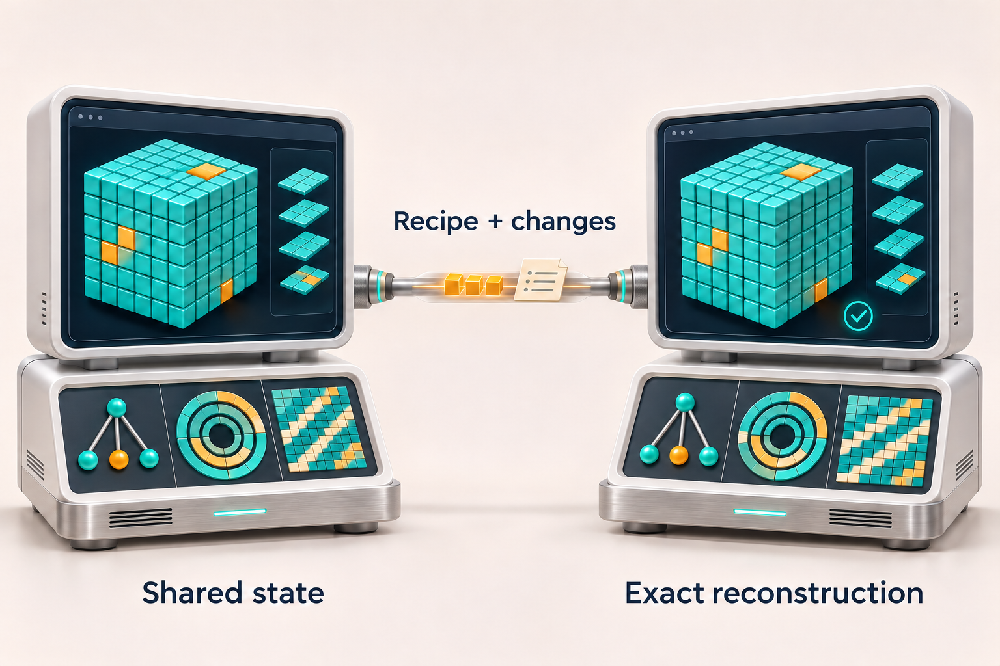
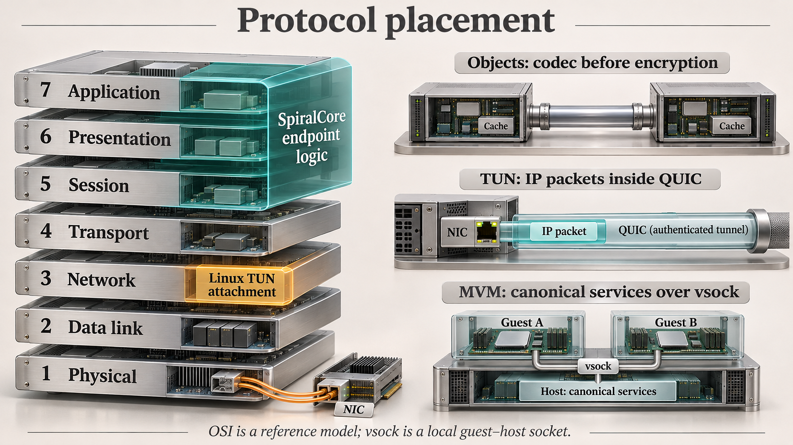
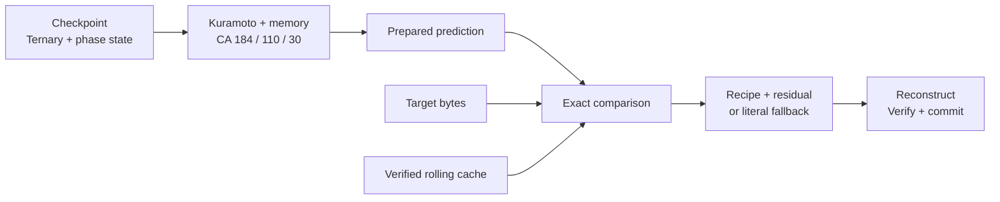
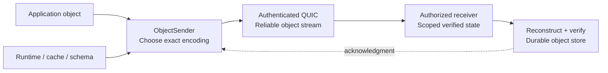
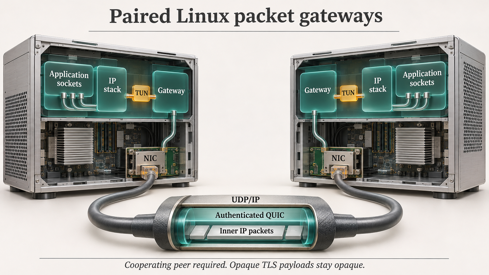
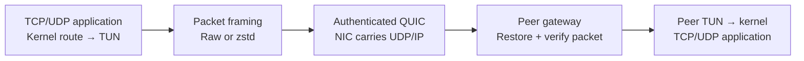
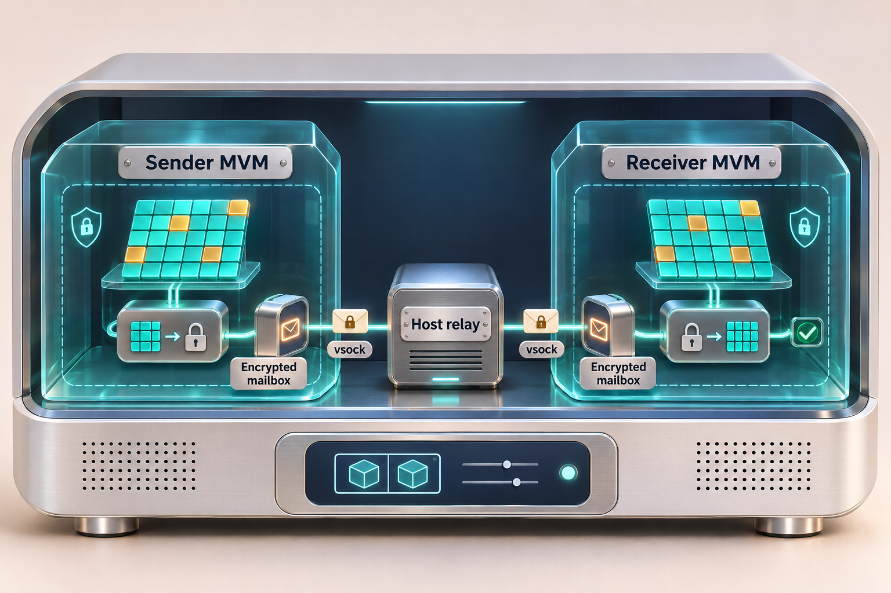
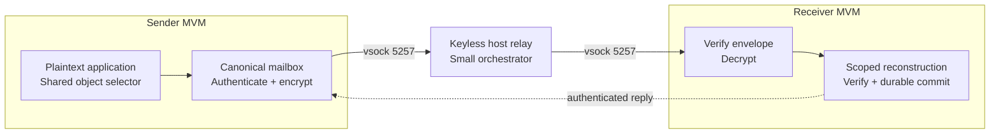

# SpiralCore

**Move fewer bytes. Reconstruct every byte. Measure the compute cost.**

SpiralCore is an experimental Rust networking project that reuses verified state
at cooperating endpoints. Instead of repeatedly sending an entire object, it can
send a reconstruction recipe, an exact residual, or a reference to an object the
receiver has acknowledged. Ternary state, Kuramoto-coupled cellular automata,
warm caches and schema fitting are active parts of the object implementation.



*The object-transfer track: turquoise represents reusable state, amber represents
changes, and the three instruments represent ternary structure, phase state and
cellular automata. These are conceptual software illustrations, not hardware
requirements or literal runtime screenshots. Reconstruction is verified against
the original bytes; a short recipe is useful only when the receiver has the
required state.*

**[Get started](#get-started) · [Results](#measured-results) · [Mechanisms](#how-the-object-core-works) · [Public evidence](docs/network/public-artifacts.md) · [Contribute](CONTRIBUTING.md) · [MIT scope](LICENSING.md)**

> Research software with working implementations and reproducible measurements.
> Exact recovery is mandatory. Byte savings, CPU savings and completion-time
> savings are reported separately, including workloads that lose.

## What works today?

**Normal networking is implemented, as well as MVM.** There are three distinct paths:

| Track | Implemented interface | Current validation | Remaining boundary |
|---|---|---|---|
| **Cooperating objects** | Authenticated QUIC object service; Combined runtime, warm cache, schema and zstd/raw selection | Persistent receivers, exact restart readback, local and calibrated shaped links | Current Combined gateway needs a two-host Internet WAN campaign |
| **Normal TCP/UDP** | Linux Layer 3 TUN → paired authenticated QUIC gateways → peer TUN | Real IPv4/IPv6 TCP/UDP flows; local and calibrated 80 ms / 10 Mbps tests | No general Internet egress/NAT or transparent warm-cache/CA compression of TCP streams |
| **MVM mailboxes** | Shared object core at authorized plaintext endpoints; canonical encrypted envelopes over vsock | Native ARM64 macOS/HVF and x86-64 Linux/Firecracker guest → host and two-guest sessions; keyless reboot readback | Experimental binding; production mailbox lifecycle, Linux rate-limit parity and WAN deployment remain open |

The normal-network gateway sends standard UDP/IP through the physical NIC, with
no NIC driver changes. Both ends need a cooperating gateway. HTTPS/QUIC payloads
reaching TUN are already encrypted and generally offer little compression.
Shared-runtime and warm-object gains currently belong to the **object and MVM
tracks**, not arbitrary encrypted packet traffic.

**Platform scope:** the normal TUN gateway is Linux-native. The MVM witness has
macOS/HVF and Linux/Firecracker host paths; the default Linux build is the guest,
and the `linux-host` feature selects the host. Native ephemeral mailbox-client
tests have passed on Windows Server 2022/2025 x64 and Windows 11 ARM64 at the
[current shared-broker source checkpoint](docs/network/evidence/2026-11-02-sustained-broker/qualification/platforms-final/README.md).
Windows private/durable object storage and packet attachment still need a port.
A portable mailbox client does not establish a Windows MVM host. The current
published MVM dependency has passed the recorded seven-platform contract run.
[Linux build and lifecycle details →](docs/network/linux-firecracker.md)

**MVM delivery roadmap:** [GitHub issue #42](https://github.com/R4-Laboratories/SpiralCore/issues/42)
is the status authority for the canonical mailbox service, admitted FlowMux
integration, owner access and final upstream contribution. The
[platform contract](docs/specs/2026-11-02-mvm-platforms.md) distinguishes supported
endpoint roles from candidate OS/version/architecture cells. Native execution,
real WAN pairs and unavailable backend gates are tracked separately in
[#46](https://github.com/R4-Laboratories/SpiralCore/issues/46) and
[#47](https://github.com/R4-Laboratories/SpiralCore/issues/47). The [current canonical-service native report](docs/network/evidence/2026-11-02-mvm-service/native-ae12/README.md)
records **16 successful Linux/Firecracker and macOS/HVF sessions**, including
one-guest/host and two-guest transfers, 32 successful guest boots and 72 exact
keyless reboot readbacks. At the larger tier (14,851,384-byte objects), complete
mixed sessions used **41.7–41.8% fewer canonical stream bytes** than prepared
whole-object zstd/raw with the same warm probe. Endpoint CPU and sender elapsed
were lower in all eight paired session comparisons; small-session lifecycle and
individual-operation losses remain visible in the report. These are single-trial
local native observations, with different backend rate profiles; cross-platform
WAN support remains unqualified. Historical results below retain their own sources. Fleet capacity and
long-lived operation are an additional release gate in
[#49](https://github.com/R4-Laboratories/SpiralCore/issues/49); two guests do not
establish a scalable deployment envelope. The
[scale boundary review](docs/network/evidence/2026-11-02-mvm-service/qualification/scale-boundary.md)
records the starting ownership, retained-state and serial-dispatch constraints.
The [shared-broker load report](docs/network/evidence/2026-11-02-broker-scale/README.md)
now records the implemented shared budget/clock, stable ordering and 2/8/32 logical
endpoint runs. Stable scopes reduced peak RSS in every matched cell and retained
3/12/48 FIFO checkpoints instead of roughly 1,950 in the paced runs. CPU and
latency varied; saturation still reached another admission limit. These local
serial-dispatch results do not qualify concurrent fleet or WAN capacity.

The newer [sustained broker report](docs/network/sustained-broker-results-2026-11-02.md)
records exact quota attribution, recovery after a real five-minute retention
wait, and **13,684 completed Linux logical-endpoint operations with 20,537 exact
readbacks** across concurrent 2/8/32-endpoint and interference profiles. Seven
additional Firecracker sessions verified **62 publications and 44 keyless reboot
readbacks**. In the large two-MVM pilot, Combined used **62.51 MB of logical
mailbox traffic / 2.946 s timed sender CPU / 6.309 s full lifecycle**, versus
zstd's **107.27 MB / 4.342 s / 8.580 s**. Across both vsock hops, accounted stream
bytes total twice the logical traffic; the report defines the CPU intervals.
These are bounded local profiles and single native pilots. The Mac one-second
deadline failure, shared-budget raw refusal, higher Combined memory use and
small-session lifecycle loss remain recorded. Canonical WAN, aggregate
cross-process fleet budgets and durable Windows gateway qualification remain
open release gates.

The [persistent-service checkpoint](docs/network/persistent-mvm-service-results-2026-11-03.md)
now moves object work outside shared mailbox dispatch and bounds the two-guest
keyless relay's link/frame/buffer ownership. Five further Linux/Firecracker
sessions passed **44 publication operations and 36 keyless reboot readbacks**.
The larger Combined session used **62.54 MB / 3.012 s timed sender CPU / 6.471 s
full lifecycle**, versus zstd's **107.25 MB / 4.437 s / 8.807 s**. The smaller
Combined session retained a **1.95% lifecycle loss**. Reports explicitly separate
orchestrator transport credits from guest plaintext/cache budgets; the latter,
safe sessions beyond 2,048 Calls, negotiated pipelining and canonical WAN remain
active work in the [recorded plan](docs/plans/2026-11-03-persistent-mvm-service.md).

### Where SpiralCore sits in the network stack



*For network engineers: the left side is a functional OSI mapping; the right side
shows the implemented stacks. Object identity, codecs, reconstruction and transfer
state live in SpiralCore's application protocol. They are not separate OSI Layer
5/6 wire protocols. The packet gateway attaches at Layer 3 through Linux TUN and
encapsulates inner IP packets in QUIC datagrams over outer UDP/IP. The object
service instead uses reliable QUIC streams. Existing NIC/link layers remain
ordinary networking. MVM's mailbox is an application protocol over a separate
guest–host virtio-vsock path, not a standardized OSI Layer 5 mailbox.*

[View the full-resolution OSI illustration](docs/figures/overview/osi-model.png)
· [Object protocol](docs/network/runtime-object-gateway.md)
· [Packet gateway](crates/spiralcore-gateway/README.md)
· [MVM boundary](crates/spiralcore-mvm-adapter/README.md)

**Protocol integration:** the [v1 object contract](docs/specs/spiralcore-v1.md)
defines the shared Rust sender/receiver API, stable frame format and codec IDs.
The canonical MVM adapter and cooperating QUIC object service pin the same
`object-v1` profile. Profile metadata grants no authority; each carrier retains
its own authentication and policy checks. Dynamic wire negotiation, transparent
packet/stream profiles and guest management services remain separate work.
The [v1 integration results](docs/network/v1-endpoint-results-2026-11-02.md)
record 24 native Linux sessions, 240 exact publications and 120 keyless reboot
checks. Transfer behavior is preserved; the small-session CPU regression is
reported explicitly rather than counted as a speed improvement.

## Measured results

These experiments have different workloads and accounting layers. Do not combine
their percentages. Elapsed already includes computation; CPU is not an additional
latency charge. Each report retains setup, durability, loss and trial details.

### Normal networking: real TUN sockets on a constrained link

The [packet campaign](docs/network/packet-selection-results-2026-11-01.md) completed
**32 sessions, 128 application transfers and 256 exact endpoint receipts**.
The campaign covers unshaped and shaped links plus IPv6 smoke sessions. The table
shows primary IPv4 shaped-link trials: three 16 MiB TCP objects—patterned, opaque,
patterned—on one persistent connection, plus UDP smoke. This is actual Linux
TUN/QUIC traffic on a calibrated **80 ms RTT / 10 Mbps** bidirectional link on one host.

| Mode | Captured IP bytes, both directions | Both gateways' CPU | Three-object client completion |
|---|---:|---:|---:|
| Raw packets | 62,681,599 | 4.947 s | 46.953 s |
| Conventional zstd | 28,472,420 | 3.294 s | 20.540 s |
| Fast zstd | 28,034,434 | 3.137 s | 20.653 s |

Three-trial medians. Fast zstd reduces IP bytes **55.28%** and gateway CPU
**36.42%** versus Raw by paired medians. On the fast unshaped local link it is
slower: **0.904 s versus Raw's 0.773 s**. Adaptive remains experimental because
it can sacrifice bytes. These packet gains use conventional compression, not CA
or ternary replay. [Full report and losses →](docs/network/packet-selection-results-2026-11-01.md)

### Combined object gateway: shared state plus exact changes

The [current selector campaign](docs/network/cpu-conscious-results-2026-11-02.md)
completed **288 exact reopened deliveries across 18 local/shaped sessions**. Each persistent session includes
1,047,202-byte and 14,851,384-byte targets, eight targets per size, and paid
checkpoint/schema setup. The table shows authenticated QUIC transfers on the
calibrated shaped-link profile, separate from the packet experiment.

| Mode | Captured IP bytes, both directions | Both endpoints' process CPU | Client completion |
|---|---:|---:|---:|
| Exhaustive Combined, default | 33,946,691 | 1.955 s | 31.038 s |
| CPU-conscious Combined, opt-in | 33,943,850 | 1.924 s | 31.061 s |
| Prepared whole-object zstd | 58,149,609 | 2.471 s | 49.862 s |

The opt-in mode retains **41.63% fewer IP bytes, 21.83% less process CPU and
37.71% less elapsed** than zstd by paired medians. It is not uniformly better
than exhaustive selection: full-session elapsed is 0.045% worse in this dose,
and unrelated objects retain overhead. [Workload and remaining costs →](docs/network/cpu-conscious-results-2026-11-02.md)

### MVM on macOS/HVF: Combined through actual guest/vsock boundaries

The [MVM report](docs/network/mvm-combined-results-2026-11-02.md) records **36 real
guest sessions, 336 exact publications including setup, and 168 separate keyless,
read-only reboot verifications**. Below is the two-MVM eight-target session;
each target contains **14,851,384 bytes**. All modes use the same explicit
64 MiB/s mailbox allowance; Combined pays checkpoint/schema costs. The default
4 MiB/s policy is unchanged.

Sender session time includes fixture/codec setup and sends. VM boot and independent
reboot/readback are measured separately. The CPU column is sender process CPU;
receiver and enclosing VM-worker CPU remain separate in the full report.

| Mode | Encrypted logical stream bytes, both directions | Sender CPU | Sender session elapsed |
|---|---:|---:|---:|
| Exhaustive Combined | 56,538,203 | 1.442 s | 2.621 s |
| CPU-conscious Combined | 56,535,989 | 1.422 s | 2.568 s |
| Prepared whole-object zstd | 97,329,036 | 1.925 s | 3.599 s |

Exhaustive Combined saves **41.92% of stream bytes, 25.37% of sender CPU and
29.21% of elapsed** by three-trial paired medians. Both vsock hops together
carry twice the logical count. A generated target alone uses **33,866 encrypted
bytes / 63.6 ms**, versus **6,118,673 bytes / 274.4 ms** with zstd. An opaque
sparse edit uses **26,846 bytes / 61.8 ms**, versus **28,450,629 bytes / 866.6 ms**.

Schema fit/drift save only about 0.7–1.1% of bytes here and cost more CPU/time.
An interrupted transfer cannot publish its partial object; a fresh authenticated
connection recovers exactly. This is local native MVM execution, not production
mailbox activation or a new WAN result. [Sizes, recovery and full testing report →](docs/network/mvm-combined-results-2026-11-02.md)

### MVM on Linux/Firecracker: native host implementation

The [Linux campaign](docs/network/linux-mvm-results-2026-11-02.md) completed
**36 native sessions, 336 exact publications and 168 keyless reboot checks**.
The two-guest eight-target batch below uses 14,851,384 bytes per target and pays
Combined checkpoint/schema setup. Medians of three trials:

| Mode | Encrypted logical mailbox bytes, both directions | Sender CPU | Sender session elapsed |
|---|---:|---:|---:|
| Exhaustive Combined | 56,558,976 | 1.201 s | 2.084 s |
| CPU-conscious Combined | 56,544,015 | 1.181 s | 2.048 s |
| Prepared whole-object zstd | 97,347,823 | 1.340 s | 2.425 s |

CPU-conscious Combined saves **41.92% of mailbox bytes, 11.84% of sender CPU and
15.00% of elapsed** by paired medians. Two mailbox hops carry twice the logical
count; these counters exclude the separate exit service and virtio headers.
The Linux path is currently unshaped, so its timings are separate from HVF's
rate-limited campaign. The 1 MiB tier saves about 35% of bytes but has sender-CPU
regressions and a one-guest elapsed regression; schema and unrelated objects
also retain per-operation costs. A forced early worker death
failed the session and cleaned up its owned VMM. [Full results, losses and remaining qualification →](docs/network/linux-mvm-results-2026-11-02.md)

### Earlier real Internet WAN evidence

An earlier GitHub Linux sender reached a native Apple M1 receiver through a
temporary HTTPS relay. The [broad WAN campaign](docs/network/broad-wan-results-2026-10-29.md)
completed **2,640 exact operations**, with 30 paired trials per case. For a
32-byte edit to a warm 16 MiB object:

| Method | Request + reply HTTP-body bytes | Completion, including compute | Sender + receiver-handler CPU |
|---|---:|---:|---:|
| Raw full send | 16,814,026 | 1,594.631 ms | 100.872 ms |
| Configured zstd prefix delta | 26,245 | 240.178 ms | 101.087 ms |
| Sparse COPY/LITERAL | 600 | 237.108 ms | 79.839 ms |

The conventional delta baseline is close in time. Including a paid seed and one
update, Sparse takes **1,873.202 ms versus Raw's 3,153.206 ms**. Historical
HTTP-body results are not NIC-byte counts and do not qualify the newer QUIC/MVM
deployment. [All baselines, seed costs and capture limitations →](docs/network/broad-wan-results-2026-10-29.md)

## How the object core works

```text
Decode(verified receiver state, versioned recipe, exact residual) = original bytes
```

The original length and whole-object SHA-256 identity are verified before a
publication acknowledgment. A hash identifies content; it does not grant access.
State is scoped by authenticated tenant, recipient and policy/epoch.
Recipes select built-in bounded transitions/codecs; received source code is never executed.

<details>
<summary>Technical detail: prediction, residual and verification</summary>



</details>

| Mechanism | Concrete job |
|---|---|
| **Ternary structure** | The imported immutable store builds ternary DAGs for sharing; the coupled runtime also retains ternary state. DAG and runtime prediction are distinct mechanisms. |
| **Kuramoto + CA** | Replay bounded, versioned transitions from a canonical checkpoint. Logical steps and pinned software math make replay reproducible; physical clock synchronization is not required. |
| **Warm cache + sparse deltas** | Reuse an acknowledged object and send exact COPY/LITERAL changes, including length changes. Repeats avoid unnecessary re-encoding. |
| **Prepared state** | Reuse predictions and codec state across transfers; measure the preparation cost. |
| **Schema fitting** | Share a fitted template and compress the value/literal stream. Unmatched content remains exact literal data. |
| **Byte-first selection** | Compare eligible runtime, sparse, schema, whole-zstd and raw encodings. Exhaustive is default; CPU-conscious may omit schema work and miss a smaller encoding outside the measured workload. |

Predictable data can have a short recipe. All required information must still
exist in verified receiver state or cross the link as residual/literal data.
Ternary structure does not remove independent information; prediction quality
determines savings, and final verification enforces zero fidelity loss.

### Track 1 — cooperating applications and objects

The opening illustration shows this path: each endpoint retains authorized
state, a compact recipe or delta crosses the link, and the receiver reconstructs
and verifies the complete object. If reuse does not help, selection falls back
to whole-object zstd or raw bytes.

<details>
<summary>Technical detail: the reliable object service</summary>



</details>

`spiralcore-gateway-object` uses the separate `spiralcore-object/1` ALPN. Peers
agree on scope and policy epoch; checkpoint/schema readiness is explicit.
[Object service and configuration →](docs/network/runtime-object-gateway.md)

### Track 2 — ordinary TCP/UDP sockets and the NIC



*Ordinary applications keep their sockets. A virtual TUN interface brings routed
packets into the software gateway; the physical NIC carries ordinary UDP/IP.
The peer restores the packets and delivers them through its TUN interface.
The illustrated assembly is software running on normal CPUs, not an add-in card.
Packet payloads use raw/zstd selection; this path does not yet apply cross-packet
warm-cache or CA reconstruction.*

<details>
<summary>Technical detail: independent packet encoding and delivery</summary>



</details>

The service attaches an existing TUN interface, validates address allowlists and
uses bounded fragmentation/reassembly. Packet encodings are independent: no
cross-packet base is assumed. This is a Layer 3 paired tunnel, not a Layer 2
bridge or transparent compression for arbitrary Internet destinations.
[Linux setup, certificates, routes and demonstration →](crates/spiralcore-gateway/README.md)

### Track 3 — MVM mailboxes and a small orchestrator



*The native two-guest witness: encoding happens inside the sender's authorized
plaintext boundary, before mailbox encryption. The host relays sealed envelopes
over vsock. The receiver authenticates and decrypts inside its guest, then
reconstructs, verifies and commits. The host's small orchestrator manages the
guests without becoming a plaintext compression endpoint. This picture depicts
the local host test; it is not evidence of a two-host MVM WAN deployment.*

<details>
<summary>Technical detail: mailbox encryption and acknowledgment boundaries</summary>



</details>

The witness also supports a single guest with a host endpoint. It uses actual
ARM64 Linux guests on macOS Hypervisor.framework and x86-64 Linux guests on
Linux/Firecracker, with a pinned MVM patch. The Linux pilot uses an unshaped
mailbox path; its requested rate profile is not reported as an enforced limit.
**5257 is experimental; FlowMux 5253 is separate and unchanged.** Publication
acknowledgment does not promise exactly-once application processing.
[Native MVM build/run instructions →](crates/spiralcore-mvm-live/README.md)

## Get started

Use Rust **1.97.1** to reproduce recorded builds. Crates are standalone Cargo
packages with their own lockfiles; no root workspace is required.

```sh
git clone https://github.com/R4-Laboratories/SpiralCore.git
cd SpiralCore
rustup toolchain install 1.97.1 --profile minimal

# Local TCP object-transfer demo; choose a fresh cache path.
cargo +1.97.1 run --release --locked \
  --manifest-path crates/spiralcore-transfer/Cargo.toml \
  --bin spiralcore -- demo --cache local/first-demo/cache

# Build the normal packet gateway and cooperating object service.
cargo +1.97.1 build --release --locked \
  --manifest-path crates/spiralcore-gateway/Cargo.toml --bins
```

The demo is an unauthenticated, loopback-only synthetic harness, not a WAN service
or benchmark. The gateway paths use their documented authenticated transports.
Linux TUN needs its documented privileges and interface setup. Native MVM needs
the pinned patch, guest kernel and HVF host.

| Task | Guide |
|---|---|
| Send/retrieve objects and run the local demo | [Transfer crate](crates/spiralcore-transfer/README.md) |
| Run paired Linux TUN gateways | [Packet gateway](crates/spiralcore-gateway/README.md) |
| Use Combined, runtime or warm object profiles | [Object gateway](docs/network/runtime-object-gateway.md) |
| Run actual MVM guests | [MVM witness](crates/spiralcore-mvm-live/README.md) |
| Inspect the canonical mailbox boundary | [MVM adapter](crates/spiralcore-mvm-adapter/README.md) |
| Review measurements and downloads | [Public artifacts](docs/network/public-artifacts.md) |

## Public evidence and reproducibility

Source, contracts, compact raw observations, failed cases, analysis and reviews
live in Git. The [public evidence release](https://github.com/R4-Laboratories/SpiralCore/releases/tag/evidence-2026-11-02)
provides reviewed MVM, object-gateway and packet-gateway receipts and captures
without Hugging Face access. [Checksums and source revisions →](docs/network/public-artifacts.md)
These evidence bundles exclude nine archived executables whose complete third-party
redistribution notices were not bundled. Their recorded hashes and public source
pins remain available; build from source using the recorded instructions.

The existing [Hugging Face preservation dataset](https://huggingface.co/datasets/caseyallard/spiralcore-experiment-artifacts)
remains a private backup, not a prerequisite for reviewing these current results.
The older 7.7 GB WAN preservation snapshot contains raw network metadata and is
not republished wholesale; its compact observations/results are public in Git.
[Historical custody and restoration →](docs/network/artifact-storage.md)

## Research and repository map

| Location | Contents |
|---|---|
| `crates/spiralcore-transfer` | Exact protocol, bounded codecs, coupled runtime and verified scoped storage |
| `crates/spiralcore-gateway-core` | Shared object and independent-packet interfaces |
| `crates/spiralcore-gateway` | Authenticated QUIC object service and Linux TUN adapter |
| `crates/spiralcore-mvm-adapter`, `crates/spiralcore-mvm-live` | Canonical mailbox, actual guest/vsock witness and small orchestrator |
| `crates/uor-r4-object-store` | Imported MIT immutable ternary DAG store and peer protocol |
| `docs/network` | Results, contracts, protocol decisions and evidence |
| `projects/spiralcore`, `references`, `archive` | Preserved prototypes, supplied research and historical artifacts |
| `index.html` | Preserved SpiralCore v69 research webpage |

The [research webpage](https://spiralcore.netlify.app/), [FBS mechanism guide](docs/mechanisms/spiralcore-fbs.md)
and [geometry diagram](docs/figures/mechanisms/spiralcore-fbs.svg) preserve the
broader geometry/E8 and routing work. Those research routing mechanisms are not
automatically enabled in the packet gateway. Counterfactual CA rows participate
in runtime evolution; this does not establish deployed counterfactual routing.

Follow the [optimization ledger](docs/network/optimization-ledger.md) for the full
experiment history and [delivery status](docs/network/delivery.md) for next work:
two-host qualification of the latest gateways, production MVM integration and
bounded stream adaptation. No FIPS/CUI, physical-energy or general-purpose router
qualification is claimed.

## License and provenance

SpiralCore's **original code and new documentation are MIT-licensed**. Imported
components retain their notices and terms. Third-party research, owner-supplied
reference artifacts and historical exports are excluded from this new grant
unless independently licensed. See [LICENSE](LICENSE), [scope](LICENSING.md)
and [provenance](PROVENANCE.md).
