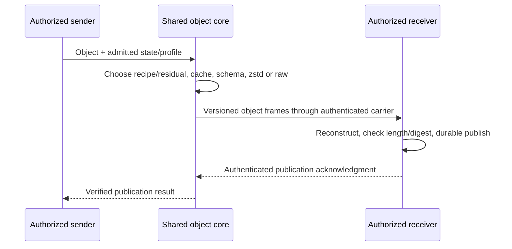
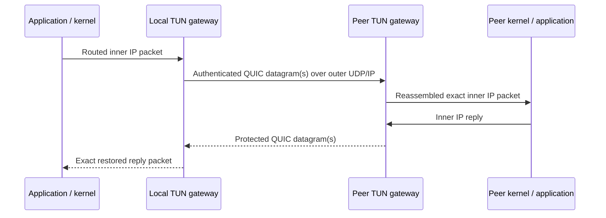
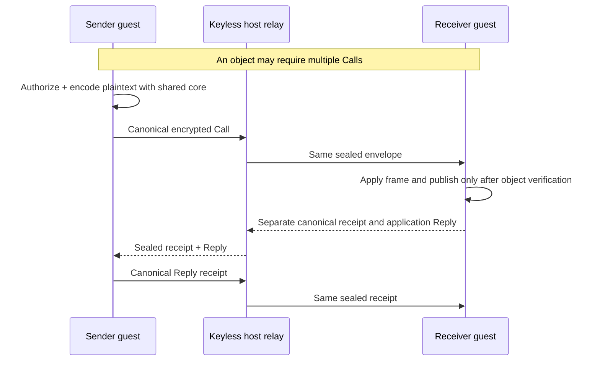

# SpiralCore

**Move fewer bytes. Reconstruct every byte. Measure the compute cost.**

SpiralCore is an experimental Rust networking and lossless object-transfer project. Cooperating
endpoints reuse verified state, compare exact encodings, and send the information
needed to reconstruct the original bytes. The implementation combines warm-object
reuse, sparse deltas, schema codecs and bounded ternary/Kuramoto/CA replay with
conventional zstd/raw controls.


*The four images are conceptual software illustrations, not custom hardware or
experimental evidence. [Figure provenance →](docs/figures/overview/README.md)*

[Start here](#build-and-run) · [Architecture](#architecture-and-protocol-boundaries) ·
[Measured results](#selected-matched-results) · [Current status](docs/network/current-status.md) ·
[Evidence](docs/network/public-artifacts.md) · [Contributing](CONTRIBUTING.md)

<a id="what-works-today"></a>

## Current delivery status

Working components and measured native demonstrations are published. The complete
installed MVM networking contribution is still in development. The
[GitHub roadmap, #42](https://github.com/R4-Laboratories/SpiralCore/issues/42), is
the delivery authority; a component merge or green platform test is an intermediate
checkpoint, not completion of that program.

**Verified durable delivery and clean shutdown between two Linux/Firecracker guests.** Guest A staged a 313-byte SpiralCore frame. Guest B recovered all 257 payload bytes, including the trailing zero, synced and reopened its guest file, acknowledged its original lease and returned the readback for independent comparison. The host verified B’s signed durable receipt after **118.420 ms**. The ACK and exact application readback took **850.304 ms** from A’s first Call. The original helpers exchanged **5,856 bytes toward B and 1,207 back** and both exited unassisted with code 0. This single same-host run measures the mailbox workflow. WAN and matched zstd qualification remain open. [Original socket counters, CPU, timings and reproduction](docs/network/evidence/2026-11-12-paired-mailbox/paired-durable-native/graceful.md) · [Earlier assisted result](docs/network/evidence/2026-11-12-paired-mailbox/paired-durable-native/README.md).

Earlier witnesses isolate stages of this path. The host exercised two independently addressed own mailboxes, one guest recovered and acknowledged its own durable object, and two host adapters retried a sealed envelope across a journal restart. The earlier addressed guest Calls timed out before readback. [Two own mailboxes](docs/network/evidence/2026-11-12-paired-mailbox/firecracker.md) · [Single-guest readback](docs/network/evidence/2026-11-12-paired-mailbox/own-mailbox-native/verified-own-mailbox.md) · [Restart and retry](docs/network/evidence/2026-11-12-paired-mailbox/durable-host-binding/README.md) · [Earlier deadline result](docs/network/evidence/2026-11-12-paired-mailbox/addressed-native-launch/paired-deadline-native.md).

The [installed-startup report](docs/network/evidence/2026-11-11-startup-publication/README.md)
records actual Linux worker/signing-helper checks: a fresh installation starts
and collects its original signer; a previously used installation with a missing
journal refuses before readiness; a directly invoked worker with no configured
home refuses without modifying its owned fixture. The publication/custody/replay
candidate passes 21 selected cases. A [Linux daemon recovery test](docs/network/evidence/2026-11-11-retained-recovery/README.md)
now shows a signed deregistration waiting for its original handler and preserving
the other VM’s record; conflicting inventory refuses without a rewrite. Eight
[follow-up checks](docs/network/evidence/2026-11-11-retained-recovery/original-row/README.md)
pass after binding resumed callers to their original resource charges. In a
[Linux worker recovery test](docs/network/evidence/2026-11-11-retained-recovery/worker-shutdown/README.md),
the client received the deregistration reply and the worker collected its original
signer before exiting. Retirement with a per-VM mailbox helper remains open.

| Path | Published implementation and evidence | Remaining acceptance |
|---|---|---|
| Cooperating objects | Authenticated QUIC object service; shared runtime/cache/schema core; exact durable readback | Current-source two-host Internet WAN qualification |
| Ordinary TCP/UDP | Linux TUN paired tunnel over authenticated QUIC; real IPv4/IPv6 flows and calibrated shaped-link trials | Other packet-attachment platforms and deployment/WAN acceptance |
| MVM mailbox | Canonical encrypted envelopes, native HVF/Firecracker transfers, and installed Firecracker qualification for sustained Calls and receipt recovery | Complete installed-service release, concurrent capacity, canonical WAN, and security qualification |
| FlowMux stream component | Authenticated paired TCP/TLS/object mapping, cancellation and FIN ownership; **34 tests on each of seven native roles** | Canonical admitted MVM binding, installed lifecycle, sustained capacity and WAN |
| Installation/storage foundations | Installed-owner/supervisor components, managed reservations and native Windows private-storage components | End-to-end aggregate ownership, recovery and supported capacity envelope |
| Owner access | Development/sealed-mode integration is active, unmerged work | Canonical authority/lifecycle, shared-core payload binding and native acceptance |

The latest published FlowMux component is [PR72](https://github.com/R4-Laboratories/SpiralCore/pull/72),
merged as `25a1c786`; [PR77](https://github.com/R4-Laboratories/SpiralCore/pull/77)
publishes its [reviewed release packet](docs/network/evidence/2026-11-03-flowmux/pr72-release.md).
This is a native-process component, not a booted-MVM or WAN result.

Unmerged work includes the canonical resident parent, exact-process guardian
custody, disposable endpoint-disk inventory, admitted FlowMux/access activation,
and Small/Ordered/readiness candidates. These are not part of PR72's accepted
source. [Current checkpoints, failures and open gates →](docs/network/current-status.md)
Published development code: [SpiralCore integration `8476d758`](https://github.com/R4-Laboratories/SpiralCore/tree/8476d7583e083e02d8b6bc571fc505815b85de90)
and [MVM fork `081901d02`](https://github.com/Casey-allard/mvm/tree/081901d0285ccf00d9dd824746354e9f82d8b6ce).
The [resident lifecycle report](https://github.com/R4-Laboratories/SpiralCore/blob/ef4f5530cb4df41ef534dd63b149f2de5dd107b3/docs/network/evidence/2026-11-04-resident-service/README.md)
records one original backend, two cancellation-safe resident slots, real registry
resource drain and protected lifecycle tests. A caught operation panic fences the
whole owner. The public dependency graph and remaining endpoint/native gates are
recorded explicitly. The newer helper fixes are now published directly
in the MVM fork; the earlier source bundle remains a historical recovery record.
The latest [endpoint-owner checkpoint](https://github.com/R4-Laboratories/SpiralCore/blob/24e6c96df30a84ecb486e788a3f2b70fbfbe5412/docs/network/evidence/2026-11-04-endpoint-owner/README.md)
connects actual guest, endpoint and disposable-store reservations to the canonical
partition and resident cleanup path. Eleven focused Linux entries and strict
Clippy pass; two reproduced ownership/cleanup defects and their fixes are retained.
The resource profile remains inactive pending the complete helper model and
positive native endpoint-retirement witness. These tests boot no guest and add no
new transfer-performance claim.
These checkpoints are available for review; native installed integration,
capacity and WAN performance still require acceptance on the final combined source.

The [resident/helper successor](https://github.com/R4-Laboratories/SpiralCore/blob/7a080af1049455f6cb0e07f511cb467d05a902e8/docs/network/evidence/2026-11-04-resident-helper/README.md)
connects the actual canonical daemon/signer to the resident's original backend.
It verifies shutdown and keeps resource credits charged until the final registrar
reference drops: 22 ordinary passing checks plus one separately executed actual
helper case. Its original config/admission binding and dependency identities are
recorded with the source. These tests boot no guest.

The [mandatory telemetry capacity check](https://github.com/R4-Laboratories/SpiralCore/blob/f7d06da6b4aa148cd348dd91df3342f1bc53e399/docs/network/evidence/2026-11-04-retained-telemetry/README.md)
now rejects an endpoint allowance smaller than the canonical 8 MiB records cap
before resource or directory effects. The successor passes 23 ordinary parent
checks and strict Clippy; real-helper cases are ignored in that ordinary run.
The [retained-catalog successor](https://github.com/R4-Laboratories/SpiralCore/blob/8476d7583e083e02d8b6bc571fc505815b85de90/docs/network/evidence/2026-11-04-retained-catalog/README.md)
implements original retained-file ownership, the disposable/retained split and
durable denial after catalog loss. Its final release library run passes 152
entries with two helper cases ignored; scoped Clippy passes with three
unconnected-constructor warnings. All 134 compiled inputs match its Git source.
Original failures and independent reviews are retained. Restart adoption,
incomplete-I/O recovery and the installed producer/native consumer remain open.
The installed profile is inactive; these checkpoints add no transfer-performance,
accepted capacity or FIPS claim.

The [latest reader/TLS development checkpoint](https://github.com/R4-Laboratories/SpiralCore/blob/1025d87d048b15cefd483b4c11c70a6e029cb29c/docs/network/evidence/2026-11-03-flowmux/validation/handshake-startup/README.md)
preserves original reader ownership and promptly rejects EOF during TLS
authentication. Its 43 focused Linux checks and ten terminal-close repetitions
pass; all 385 executed source inputs match the published checkpoint. Installed
service activation remains separate. The
[scanner allocation report](docs/network/evidence/2026-11-04-owned-pii-requested/README.md)
records all 325 canonical rule selections with exact legacy output comparisons;
it informs the shared service budget without claiming an application RSS bound.

<a id="where-spiralcore-sits-in-the-network-stack"></a>

## Architecture and protocol boundaries


SpiralCore's object identity, selection, reconstruction and publication state
are application-protocol functions. Their resemblance to OSI session or
presentation functions does not make them separate standardized Layer 5/6 wire
protocols. Carriers retain their own authentication, framing and lifecycle.

| Boundary | Actual placement |
|---|---|
| Application / object core | Authorization context, object identity, codecs, reconstruction, verified publication |
| TCP/TLS component | TLS-protected TCP stream; bounded object mapping above the carrier |
| QUIC services | Reliable object streams or packet datagrams over UDP/IP; QUIC integrates TLS key establishment and packet protection |
| Linux TUN | Layer 3 attachment: inner IPv4/IPv6 packets enter a paired tunnel |
| Physical network | Ordinary outer UDP/IP and existing Ethernet/Wi-Fi/NIC stack |
| MVM guest–host | Canonical application envelopes over virtio-vsock; vsock is a transport, not OSI Layer 5 or owner authorization |

**One shared Rust object core, explicitly versioned endpoint mappings.** The
[object-v1 contract](docs/specs/spiralcore-v1.md) defines the common object frames
and codec identities. The object gateway and MVM adapter reuse that core;
they do not copy a codec or replace the canonical MVM envelope. Independent
packet encoding is a separate documented mapping, not cross-packet object reuse.

Mailbox delivery, FlowMux network forwarding and owner access have **separate
admission, queues, rates, audit and lifecycle**. A mailbox grant does not authorize
network egress or a shell. A TCP destination grant does not authorize a different
UDP/QUIC exit. Profiles, hashes, vsock connectivity and successful handshakes do
not manufacture permission. [Canonical MVM delivery requirements →](docs/plans/2026-11-03-ari-delivery.md)

### Cooperating object applications

The sender prepares an eligible exact representation at an authorized plaintext
endpoint, before carrier encryption. The receiver authenticates the carrier,
checks scope, reconstructs and verifies, then commits to its private store.



Publication is distinct from exactly-once application processing. Candidate
selection can choose conventional bytes when reuse is ineffective; missing
required authority or peers cause refusal, not an insecure transport fallback.
[Object service, configuration and ALPN →](docs/network/runtime-object-gateway.md)

**For socket programmers — published FlowMux component contract:**

| API / boundary | Contract |
|---|---|
| `TlsCarrier` + enrolled `ScopeAuthority` | Match actual mutual TLS identity/role and enrolled scope before `ObjectChannel::from_authenticated`; a connected socket alone grants no permission |
| `ObjectChannel` | Send/serve shared-core objects; application `MAX_BLOCK` is **16 KiB**, not a whole-stream or whole-memory limit |
| `Duplex::split` | Separate `DuplexWriter`, `DuplexReader` and owned `JoinGuard`; retain/join lifecycle custody |
| `MappedStream` | Standard `Read`/`Write` facade over Duplex; partial I/O is normal, with a configured bound per I/O call rather than an automatic whole-stream deadline |
| Cancellation / half-close | Fatal cancel fences later buffered delivery; normal half-close preserves valid reverse drain |
| Acknowledgment | Verified object publication is not proof of application processing |

These APIs do not construct canonical MVM route/access grants.

### Ordinary sockets through a paired packet tunnel


Applications keep their TCP/UDP sockets. Operator-configured routes deliver
packets to Linux TUN; paired gateways encode independent packets and restore them
at the peer. This path uses raw/zstd selection, not CA or a cross-packet warm base.
Already-encrypted HTTPS/QUIC payloads normally have little useful redundancy.



This is a paired Layer 3 tunnel, not a Layer 2 bridge, arbitrary Internet egress,
or a NIC/driver modification. Address allowlists and bounded fragmentation/
reassembly remain enforced. [Linux setup and packet protocol →](crates/spiralcore-gateway/README.md)

### MVM mailbox and keyless relay


*The illustration shows the mailbox lane in a conceptual two-host arrangement;
it is not a qualified WAN run or a claim that every vsock service is encrypted.*

In the two-guest witness, the sender invokes the shared object core **before
canonical mailbox encryption**. The host relay forwards sealed envelopes without
message keys; it performs no plaintext compression. Reconstruction happens after
receiver authentication/decryption. A one-guest/authorized-host-endpoint variant
also exists. Keyless forwarding is not a host-blind confidential-computing claim.



Call admission, object publication, application Reply and Reply acknowledgment
are separate facts. The normal guest path remains strict; explicit reconciliation
reuses the original Call identity and deadline rather than silently retrying.
MVM assigns **vsock port 5257 to the mailbox**. FlowMux uses its own service on **5253**. For the trusted-host local-durable path, the destination helper commits the sealed envelope to its journal before signing a V2 receipt. The reader’s later ACK identifies the delivery lease. A forwarding relay can carry the envelope and receipt without holding the journal’s signing key. [Upstream port allocation](https://github.com/tinylabscom/mvm/blob/8fd62a0d4958fad1d0e61114b35a7576a2e7a10e/crates/mvm-contract/src/protocol/mailbox.rs#L15) · [Journal and endpoint bindings](docs/network/evidence/2026-11-12-paired-mailbox/addressed-native-launch/ari-journal-binding.md).
[Native witness](crates/spiralcore-mvm-live/README.md) ·
[Reconciliation](docs/network/session-reconciliation-results-2026-11-03.md)

<a id="how-the-object-core-works"></a>

## Mechanisms and exactness

```text
Decode(verified receiver state, versioned recipe, exact residual) = original bytes
```

| Mechanism | Concrete role |
|---|---|
| Ternary DAG store | Immutable structural sharing; distinct from runtime prediction |
| Ternary/Kuramoto/CA runtime | Replay bounded versioned transitions from a canonical checkpoint |
| Acknowledged warm state | Reuse an object the scoped receiver has verified |
| Sparse COPY/LITERAL residuals | Preserve exact edits, including length changes |
| Schema fitting | Share a template; encode values and unmatched literals exactly |
| Prepared state | Amortize prediction/codec setup; charge that setup in results |
| Byte-first selection | Compare eligible runtime, sparse, schema, zstd and raw representations |

A short recipe is useful only when its prerequisites are present. Independent
information must already exist in authorized receiver state or cross the link.
Length/digest checks precede publication acknowledgment; experiments additionally
compare independently reopened bytes. Hash identity does not authorize access.

For Combined, exhaustive evaluation is the published default; CPU-conscious
selection is opt-in and can miss a smaller candidate outside the measured workload.
Recipes select bounded built-in operations, not received executable code. Logical replay
steps do not establish physical clock synchronization or exact cross-machine timing;
CPU measurements do not establish energy savings.

<a id="measured-results"></a>

## Selected matched results

These are **source-pinned experiments**, not performance promises for every
current build. Accounting domains and workloads differ: captured IP, canonical
stream and HTTP-body bytes are not interchangeable. CPU is already part of
elapsed time; subtracting it does not isolate send time. All tables retain their
setup, verification, failures and source details in the linked report.

**Object gateway — three paired trials, calibrated 80 ms RTT / 10 Mbit/s.**
Source `30792f17d0a596c4344e4780ebd4b8f455e3bedb`; persistent sessions contain
eight targets at each of 1,047,202 and 14,851,384 bytes, including paid setup.

| Encoding | Captured IP bytes, both directions | Both endpoint process CPU | Client completion |
|---|---:|---:|---:|
| Exhaustive Combined | 33,946,691 | 1.955 s | 31.038 s |
| CPU-conscious Combined | 33,943,850 | 1.924 s | 31.061 s |
| Prepared whole-object zstd | 58,149,609 | 2.471 s | 49.862 s |

All 288 deliveries reopened exactly. CPU-conscious had 0.045% worse paired-median
full-session elapsed than exhaustive; on the unshaped local link its elapsed was
1.41% worse than whole-zstd. [Full workload, paired ratios and losses →](docs/network/cpu-conscious-results-2026-11-02.md)

Displayed cells are column medians. Paired percentage changes use per-trial
ratios and need not equal ratios of the displayed medians.

**Packet tunnel — three primary IPv4 trials, calibrated 80 ms / 10 Mbit/s.**
Source `9dd283ca366d6075bd6b423c3a42aa928e222ce2`; three 16 MiB TCP objects on
one persistent connection plus UDP smoke. These are shaped local Linux trials.

| Encoding | Captured IP bytes, mixed session | Both gateway process CPU | Three-object client time |
|---|---:|---:|---:|
| Raw | 62,681,599 | 4.947 s | 46.953 s |
| Conventional zstd | 28,472,420 | 3.294 s | 20.540 s |
| Fast zstd | 28,034,434 | 3.137 s | 20.653 s |

The complete campaign passed 32 sessions/256 exact endpoint receipts and retained
3,027 finite-queue congestion drops. Fast zstd was slower on the fast local link:
0.904 s versus Raw's 0.773 s. [Calibration, capture and adaptive losses →](docs/network/packet-selection-results-2026-11-01.md)

**Installed MVM witness — single local fixed-order pairs, two actual guests.**
Eight 14,851,384-byte targets; Combined pays checkpoint/schema setup. Exact source
and protected-binary identities are in the [native report](docs/network/installed-supervisor-results-2026-11-03.md).

| Native backend / encoding | Both-direction canonical bytes | Sender guest CPU | Receiver guest CPU | Lifecycle wall |
|---|---:|---:|---:|---:|
| Linux/Firecracker whole-zstd | 107,301,660 | 4.488958 s | 3.707541 s | 8.814947 s |
| Linux/Firecracker Combined | 62,491,548 | 2.963787 s | 2.519790 s | 6.392388 s |
| macOS/HVF whole-zstd | 107,276,257 | 15.335437 s | 11.293480 s | 30.038789 s |
| macOS/HVF Combined | 62,546,739 | 9.181874 s | 5.281349 s | 16.368091 s |

All objects reopened exactly through independent verifier boots. Two vsock hops
carry twice the canonical count; neither is a NIC capture. Host/VMM CPU overlaps
nested guest activity and is reported separately. The earlier smaller Linux pair
retains a 0.685% lifecycle loss. These are not matched OS comparisons or WAN runs.

Earlier [Internet WAN experiments](docs/network/broad-wan-results-2026-10-29.md)
remain useful historical evidence, with HTTP-body accounting and different
sources/transports. They do not qualify the current QUIC or canonical MVM path.

## Platform and role matrix

| Role | Recorded scope | Boundary |
|---|---|---|
| Linux x86_64 / Firecracker | Native guest transfers and installed death/recovery witness | Full resident/shared-budget/WAN acceptance open |
| Apple Silicon macOS / HVF | Native guest transfers and installed entry | HVF death recovery and integrated capacity/WAN open |
| Linux x86_64 + ARM64 | Native portable client/stream components | ARM64 component execution is not Firecracker host evidence |
| macOS ARM64 + Intel | Native portable client/stream components | Intel component execution is not native MVM hosting |
| Windows Server 2022/2025 x64 + Windows 11 ARM64 | Native client/TLS components and private-storage components | No native Windows MVM host or end-to-end durable gateway/WAN claim |
| Linux TUN adapter | Native IPv4/IPv6 packet attachment | Other attachment platforms are not established here |

The seven FlowMux rows repeat 34 tests per role; they are not 238 distinct tests,
cross-OS network pairs or booted guests. Windows storage uses the same protocol
with an isolated Win32 backend and supported NTFS profile. Portable compilation,
WSL and client success do not substitute for native backend execution.
[Platform contract](docs/specs/2026-11-02-mvm-platforms.md) ·
[Current acceptance gates](docs/network/current-status.md)

## Security and deployment scope

The MVM submission targets unclassified/CUI deployments with a concrete
FIPS 140-3 cryptographic deployment profile, tracked in
[#83](https://github.com/R4-Laboratories/SpiralCore/issues/83). Current builds
have **no established FIPS-validated deployment profile**. Qualification must
map every security-relevant operation to the exact validated module, version,
build, operating environment and approved mode. Transport crypto and canonical
mailbox/access crypto both require that mapping; changing outer TLS alone does
not qualify inner operations. [NIST CMVP](https://csrc.nist.gov/Projects/cryptographic-module-validation-program/validated-modules)
records module validations, which are distinct from whole-system security and
customer authorization.

This remains one codec/protocol with explicit deployment and endpoint profiles.
Compression runs at authorized plaintext endpoints before the canonical
encryption boundary. Encrypted relays retain their forwarding role. Tenant/cache
isolation, secret-bearing compression, replay, revocation, key lifecycle and
retained audit data need their own security evidence. Synthetic demonstrations
and lossless readbacks do not establish CUI, FIPS or classified-network approval.

<a id="get-started"></a>

## Build and run

Use Rust 1.97.1 for the recorded builds. Packages are standalone Cargo crates with
their own committed lockfiles; no root Cargo workspace is required.
The example uses a POSIX shell. Windows private storage requires a drive-absolute
NTFS root under its [native profile](docs/api/windows-storage-v1.md).

```sh
git clone https://github.com/R4-Laboratories/SpiralCore.git
cd SpiralCore
rustup toolchain install 1.97.1 --profile minimal

# Loopback-only synthetic object demo; choose a fresh cache directory.
cargo +1.97.1 run --release --locked \
  --manifest-path crates/spiralcore-transfer/Cargo.toml \
  --bin spiralcore -- demo --cache local/first-demo/cache

# Authenticated QUIC object service and Linux packet-gateway binaries.
cargo +1.97.1 build --release --locked \
  --manifest-path crates/spiralcore-gateway/Cargo.toml --bins
```

The demo is unauthenticated loopback tooling, not a WAN service. Authenticated
services need the documented peer pins, certificates, scopes and configuration.
TUN requires its documented Linux privileges/routes. Native MVM needs the pinned
MVM source, kernel, guest image and backend-specific setup; default Linux live
builds select the guest, while `linux-host` selects the host role.

| Task | Entry point |
|---|---|
| Object API, demo and verified storage | [Transfer crate](crates/spiralcore-transfer/README.md) |
| Paired packet gateways | [Gateway setup](crates/spiralcore-gateway/README.md) |
| Runtime/cache/schema object service | [Object gateway](docs/network/runtime-object-gateway.md) |
| Native MVM build and role selection | [MVM witness](crates/spiralcore-mvm-live/README.md), [Linux host](docs/network/linux-firecracker.md) |
| Canonical mailbox and FlowMux mapping | [Mailbox adapter](crates/spiralcore-mvm-adapter/README.md), [FlowMux contract](docs/api/mvm-flowmux-v1.md) |

## Evidence, research and contribution

The [UORC v0.3.0 comparison](docs/research/2026-11-10-uorc-v0.3.0-comparison.md)
examines its released context model, frame deduplication and decoder techniques
against SpiralCore's warm-cache, schema and CA paths. It records published
byte/compute tradeoffs, resource and integration limits, and proposed matched
experiments. This is source research; no production codec has been replaced.

[Public artifacts](docs/network/public-artifacts.md) link source pins, checksums,
compact raw observations, analysis, failures and reviews. The
[GitHub evidence release](https://github.com/R4-Laboratories/SpiralCore/releases/tag/evidence-2026-11-02)
provides reviewed larger captures/receipts without a private-dataset account.
Archived executables omitted from that release retain source/hash provenance;
publication does not silently relicense third-party binaries. Newer component
packets are linked from [current status](docs/network/current-status.md).

The wider geometry/E8/routing work is described in the
[FBS mechanism guide](docs/mechanisms/spiralcore-fbs.md) and
[research webpage](https://spiralcore.netlify.app/). Those ideas are not automatically
enabled routing mechanisms in the packet gateway. Rust is the active product and
measurement language; historical prototypes remain preserved.

Original SpiralCore code and new documentation are MIT-licensed. Imported code,
research and historical artifacts retain their own terms. See [LICENSE](LICENSE),
[LICENSING](LICENSING.md), [PROVENANCE](PROVENANCE.md) and [CONTRIBUTING](CONTRIBUTING.md).
